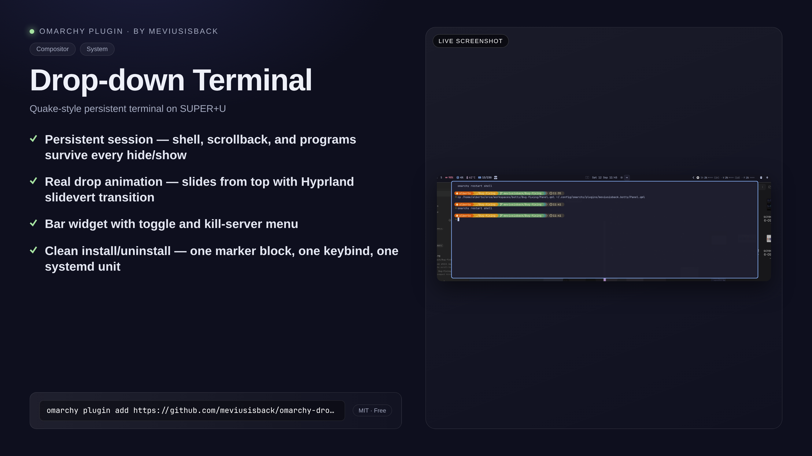

<div align="center">

# Drop-down Terminal

**A Quake-style drop-down terminal for Omarchy: press `SUPER + U` and a terminal slides down from the top of your screen — the session survives every hide, workspace switch and shell restart.**

[](LICENSE)




</div>

## Why

A scratch terminal should be one keypress away, on every workspace, with nothing lost when you dismiss it. This plugin gives you exactly that: press `SUPER + U`, type, press again — the shell, scrollback and running programs are all still there, because hiding the dropdown never kills the session.

## Features

- **Persistent session** — powered by a `foot` terminal *server* (systemd user unit). Hiding the dropdown never kills your session; only logout or an explicit kill does. If the server ever dies, the next toggle self-heals it.
- **Real drop animation, from the top** — the terminal lives on its own special workspace at the top edge; toggling plays Hyprland's `specialWorkspace` animation (easeOutQuint) with the direction pinned explicitly, so the panel **drops in from the top** and retracts upward.
- **Centered geometry** — 80% width, 45% height, just below the top bar, with a rounded 3px border. Geometry is expressed in `monitor_w/H` formulas, so the rule lands relative to whichever monitor the window first maps on. The CLI re-applies the panel's position on every open; after a resolution change, run `omarchy-dropdown-terminal kill` and reopen so a fresh window picks up the new size.
- **Click outside to dismiss** — a focus watcher hides the dropdown the moment it loses focus. It is **event-driven**: it subscribes to Hyprland's event socket (`activewindow` / `activespecial`), so it costs nothing while you work instead of polling the compositor (if the socket is missing or stale it falls back to a 2 s poll). Dismissal is click-based: the plugin sets `input:follow_mouse = 0` and `float_switch_override_focus = 0` so moving the mouse never steals focus, and `input:special_fallthrough` lets your click reach the window underneath.
- **Bar widget** — shows terminal state at a glance (accent = shown). Left click toggles, right click opens a small menu (show/hide, kill server). The state is event-driven too: the watcher publishes it to a small file the widget watches, so there is no periodic status poll.
- **IPC control** — `omarchy-shell shell toggle meviusisback.dropdown-terminal`, plus `open`, `close`, `kill` and `status` methods.
- **Clean install/uninstall** — one marker-anchored block in your Hyprland config, one line, one systemd unit. Uninstall removes the keybind block, the window rules, the hook line and the systemd unit, and restores any config file it had backed up; the single-instance lock file and the runtime state file are left in place on purpose, because unlinking a lock another process may still hold would let two watchers run at once.

## Install

```bash
omarchy plugin add https://github.com/meviusisback/omarchy-dropdown-terminal
omarchy plugin enable meviusisback.dropdown-terminal   # adds the bar widget
cd ~/.config/omarchy/plugins/meviusisback.dropdown-terminal
./install.sh                                           # keybind + rules + foot server
```

`omarchy plugin add` only puts the files on disk; `./install.sh` is the part a plugin cannot do for itself (writing your Hyprland config and enabling a user unit). It:

1. Installs a parameterized systemd user unit `foot-server@.service` (backing up any pre-existing file of that name) and enables the `dropdown-terminal` instance — a persistent `foot` server with a dedicated app-id (`org.omarchy.dropdown-terminal`) and its own socket, so your normal foot setup stays untouched.
2. Writes `dropdown-terminal.lua` (window rules) under the Hyprland config dir (`$XDG_CONFIG_HOME/hypr`, or `~/.config/hypr` when unset) and hooks it into `~/.config/hypr/hyprland.lua` (same pattern as the Omarchy workspace-layout plugin).
3. Writes a marker-anchored keybind block to `~/.config/hypr/bindings.lua`: `SUPER + U` → `~/.local/bin/omarchy-dropdown-terminal toggle`. Re-running `install.sh` is safe: it refreshes the block when its contents changed and reports `updated` when it did.
4. Reloads Hyprland. Press **SUPER + U**.

## Usage

| Key / action | Effect |
|---|---|
| `SUPER + U` | Toggle the drop-down terminal |
| Bar icon click | Toggle |
| Bar icon right-click | Menu: show/hide, kill server |
| `omarchy-shell shell toggle meviusisback.dropdown-terminal` | Toggle via IPC |

CLI (`bin/omarchy-dropdown-terminal`, on PATH once enabled as a plugin):

```
toggle   show/hide the drop-down terminal (default)
open     show it if hidden
close    hide it if shown
status   print JSON state (server, window, visibility)
kill     stop the foot server (ends the session)
install  install keybind + rules + systemd unit
uninstall remove everything the plugin installed
```

## Requirements

- **Omarchy** with its Hyprland build — toggling uses the Lua dispatch engine (`hl.dsp.workspace.toggle_special`), not the legacy `dispatch togglespecialworkspace` syntax.
- **foot** — provides `foot` and `footclient` (Arch: `pacman -S foot`). The persistent session is a foot *server*; your own foot config and windows stay untouched, because the dropdown uses its own app-id and socket.
- **systemd user instance** — the session lives in the user unit `foot-server@dropdown-terminal.service`.
- **python3** and **bash** at their absolute system paths (`/usr/bin/python3`, `/usr/bin/bash`) — standard library only; the backend, the watcher and the CLI use no third-party packages. Every tool the plugin runs is resolved to a validated absolute path, never through `PATH`, so a layout that keeps them elsewhere is not supported.
- **omarchy-shell** — for the bar widget and the `omarchy-shell shell toggle meviusisback.dropdown-terminal` IPC method.

Everything runs in your own user session: no network access, no root, and no systemd service beyond the user unit `foot-server@dropdown-terminal.service`. The bar widget additionally starts one small `focus_watcher` helper. It publishes the dropdown's visibility to the bar and hides the dropdown when focus leaves it, by calling the CLI's own `close` path; the widget stops it when it is destroyed, so a shell that dies without running its destructor can leave it holding the single-instance lock until you kill it.

## Configuration

- **Keybind** (`~/.config/hypr/bindings.lua`, marker-anchored block): `SUPER + U` calls the CLI by its absolute `~/.local/bin` path. Re-running `./install.sh` refreshes the block when its contents changed.
- **Window rules** (`~/.config/hypr/dropdown-terminal.lua`): `special_fallthrough = true`, `follow_mouse = 0` and `float_switch_override_focus = 0` — the last two turn off hover-to-focus **for the whole desktop** (focus changes on click only); that is what makes dismissal click-based. It also pins the drop direction for the `specialWorkspaceIn`/`specialWorkspaceOut` animation leaves (`slidevert top` on show, `slidevert bottom` on hide) — animations are global per leaf, so **every** special workspace on that monitor (including the Omarchy scratchpad, `SUPER + S`) drops in from the top once installed. Uninstall removes the block; delete the `hl.animation` lines to get Hyprland's default motion back.
- **State and socket** (`$XDG_RUNTIME_DIR`): the watcher publishes visibility to `dropdown-terminal.state` (0600, atomic, only on change) for the bar widget, and the foot server listens on `foot-dropdown-terminal.sock` (systemd's `%t`).

## How it works

`SUPER + U` runs the CLI, which starts the foot server via systemctl when needed, attaches a `footclient` to its dedicated socket, and dispatches Hyprland to toggle the special workspace — so startup is instant and the shell session (scrollback, vim, ssh…) persists as long as the server does. The foot server keeps one long-lived Wayland client alive while a focus watcher subscribes to Hyprland's event socket (degrading to a 2 s poll if the socket is missing or stale) and publishes visibility for the bar widget. `install` never overwrites a config file it cannot read, and test coverage pins the guarantees (`omarchy plugin validate .` plus the suites below).

Verify with:

```bash
python3 tests/test_backend.py        # 60 - config writes, keybind refresh, idempotency, unit + tool resolution
python3 tests/test_proc.py           # 20 - trusted-path resolver, bounded output, timeouts
python3 tests/test_focus_watcher.py  # 41 - event state machine, path validation, state file, socket
```

Host-static and hermetic: no compositor needed, `HOME` is repointed and systemctl calls are recorded, never run.

## Removal

```bash
./install.sh uninstall                               # keybind, rules, unit, server
omarchy plugin remove meviusisback.dropdown-terminal # plugin files + bar entry
```

Stops and disables the server (ordered to defeat the systemd respawn race), then removes the keybind block, the hook lines, the rules file and the unit.

## License

MIT — see [LICENSE](LICENSE).
